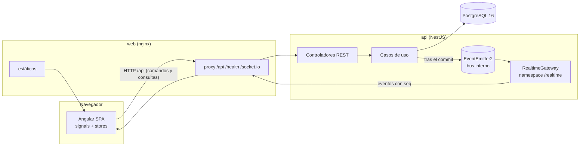
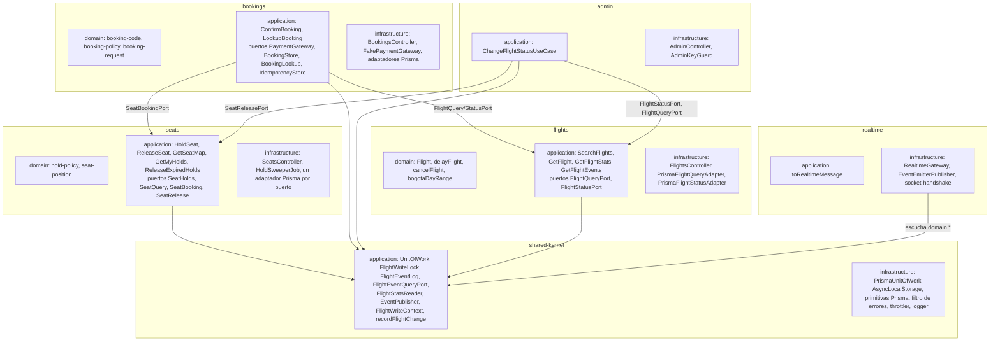
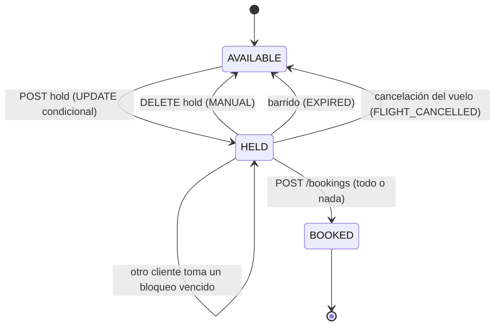
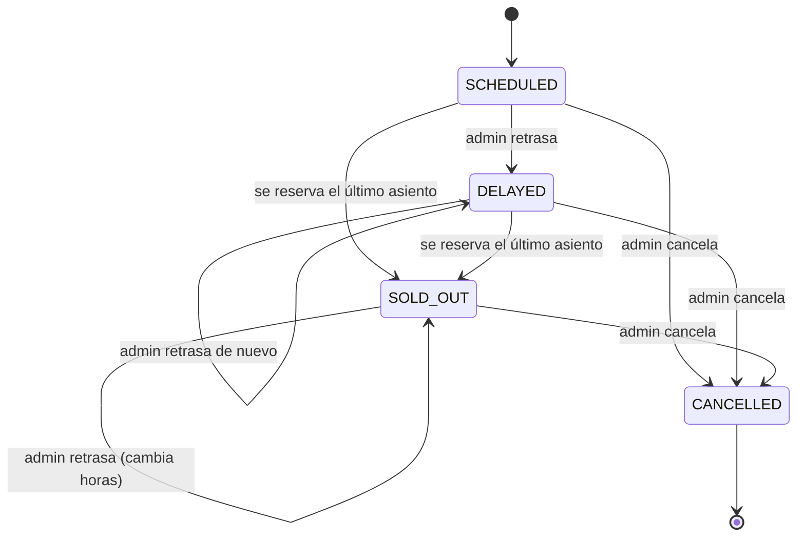
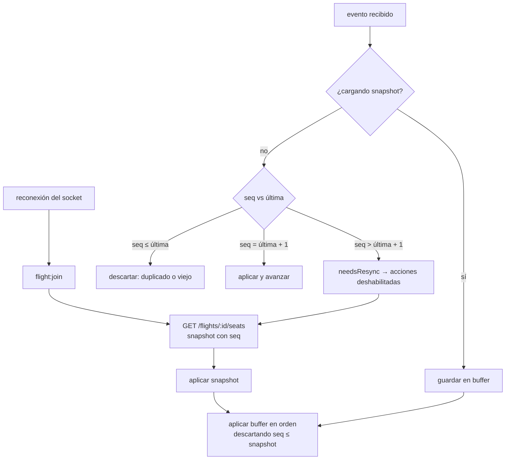

# Arquitectura

Decisiones completas y alternativas descartadas en
[research.md](../specs/001-realtime-flight-booking/research.md). Este documento describe lo que
quedó implementado al cierre de la fase 10 (constitución 1.1.0, principio IX).

## Visión general

Es un monolito modular en NestJS con arquitectura hexagonal, un frontend Angular y contratos
compartidos en `@kata/shared`. Funciona con cuatro reglas:

- Los **comandos** (bloquear, liberar, confirmar, retrasar o cancelar) van por HTTP.
- Los **cambios** se difunden por Socket.io solo después del commit (principio II).
- PostgreSQL decide cada transición de asiento con un único `UPDATE` condicional (principio I).
- El cliente solo pinta lo que confirma el servidor.



## Justificación de la arquitectura

**Monolito modular con hexágonos por módulo**, en lugar de microservicios o una aplicación en
capas técnicas:

| Criterio                                  | Por qué esta elección                                                                                                                                                                                                                       |
| ----------------------------------------- | ------------------------------------------------------------------------------------------------------------------------------------------------------------------------------------------------------------------------------------------- |
| La integridad es lo crítico               | La exclusión mutua debe decidirse en **una sola base y una sola transacción** (lock del vuelo → cliente → asiento). Con microservicios, confirmar o cancelar cruzaría servicios y obligaría a sagas o 2PC para algo que aquí es un `COMMIT` |
| Alcance de 1 día y demo local             | Un solo proceso, un `docker compose up` y nada de colas, brokers ni service discovery (principio VII, YAGNI)                                                                                                                                |
| Límites claros sin coste de red           | Cada módulo (`flights`, `seats`, `bookings`, `admin`, `realtime`) escribe solo sus tablas y expone puertos en su `index.ts`. Si mañana hiciera falta separar un servicio, la frontera ya existe                                             |
| Reglas que se prueban sin infraestructura | Hexagonal: el dominio y los casos de uso no importan Nest, Prisma ni Socket.io. Se prueban con dobles (161+ pruebas unitarias, 99 % de cobertura) y los adaptadores reales se prueban contra PostgreSQL                                     |
| Tiempo real fiable                        | Eventos publicados **tras el commit**, con `seq` por vuelo y resincronización por snapshot: un cliente nunca pinta un estado que pueda revertirse                                                                                           |

Alternativas descartadas: **microservicios** (complejidad distribuida sin beneficio a esta
escala), **serverless** (los WebSockets persistentes y el barrido periódico encajan mal),
**capas técnicas** del tipo `controllers/` y `services/` (mezclan dominios y dificultan aislar
las reglas) y **CQRS con bus de comandos** (excesivo para 4 historias). Más detalle en
research.md §1–§3.

## Decisiones técnicas clave

| Tema                  | Decisión                                                                            | Por qué                                                                                                                                                          | Alternativa descartada                                                                                                       |
| --------------------- | ----------------------------------------------------------------------------------- | ---------------------------------------------------------------------------------------------------------------------------------------------------------------- | ---------------------------------------------------------------------------------------------------------------------------- |
| Backend               | NestJS 11                                                                           | Módulos e inyección por tokens para los puertos; gateway de Socket.io, scheduler y throttler integrados                                                          | Express a mano (más código transversal); Spring o Quarkus (otro lenguaje, sin contratos compartidos con el frontend)         |
| Frontend              | Angular 22 (standalone, signals, zoneless)                                          | Stores con signals y detección de cambios fina para un mapa de 180 botones que cambia en vivo                                                                    | React (válido; Angular da DI y pruebas integradas sin elegir librerías)                                                      |
| Contratos             | `@kata/shared` con zod 4                                                            | Un esquema es a la vez validación en tiempo de ejecución y tipo, igual en backend y frontend                                                                     | class-validator (atado a Nest); generar tipos desde OpenAPI (dos fuentes de verdad)                                          |
| Protocolo de comandos | REST (`/api`) con códigos HTTP explícitos                                           | Respuesta síncrona verificable (201, 409, 410, 422…) e idempotencia por header                                                                                   | Comandos por WebSocket (sin semántica HTTP; prohibido por el principio II)                                                   |
| Protocolo de eventos  | Socket.io 4, namespace `/realtime`, rooms `flight:{id}` y `search`                  | Rooms, reconexión automática con re-join y transporte de respaldo; el handshake valida el `clientId`                                                             | SSE (sin rooms ni canal de ida; habría que reimplementar suscripciones); polling (latencia y carga)                          |
| Orden y recuperación  | `seq` por vuelo, avanzada en la transacción y guardada en `flight_events`           | El cliente detecta duplicados y huecos sin depender del broker; el tablero tiene historial                                                                       | Timestamps (no ordenan commits concurrentes); outbox (más infraestructura; el snapshot cubre el hueco)                       |
| Persistencia          | PostgreSQL 16 + Prisma 7 (adaptador `pg`)                                           | Transacciones, `UPDATE ... RETURNING`, locks de fila y advisory locks; Prisma da tipos y migraciones, y `$queryRaw` con tagged templates las sentencias atómicas | Redis con `SET NX` (una segunda fuente de verdad que sincronizar con la reserva); TypeORM (tipado más débil)                 |
| Bloqueo de asiento    | `UPDATE` condicional cuyo conteo decide; `UNIQUE(seat_id)` en `booking_seats`       | Atomicidad sin leer y luego escribir; la base hace la exclusión mutua                                                                                            | `SELECT ... FOR UPDATE` + `UPDATE` (dos pasos, más locks); versión optimista en la aplicación (reintentos)                   |
| Caché                 | **Ninguna**                                                                         | La base es la única fuente de verdad. La vista perezosa (un `HELD` vencido cuenta como disponible) y los índices bastan para 75.600 asientos                     | Redis o caché en memoria (invalidación compleja con eventos concurrentes; riesgo de mostrar un asiento libre que no lo está) |
| Expiración            | Barrido cada 2 s (`@nestjs/schedule`) + vista perezosa                              | La corrección no depende del job; el job solo notifica a tiempo (≤ 2 s)                                                                                          | Solo vista perezosa (nadie avisaría al vencer); TTL de Redis (otra fuente de verdad)                                         |
| Bus interno           | EventEmitter2 (`@nestjs/event-emitter`)                                             | Desacopla los casos de uso (publican eventos de dominio) del gateway, en el mismo proceso                                                                        | Broker externo (Kafka o RabbitMQ: innecesario para un monolito)                                                              |
| Seguridad             | helmet, CORS, throttler, zod en toda entrada, `timingSafeEqual`, pino con redacción | Ver la sección Seguridad                                                                                                                                         | —                                                                                                                            |
| Pruebas               | Jest + Supertest + Testcontainers; Vitest en Angular; Playwright con Chrome         | Las e2e contra la base y el socket reales encontraron bugs que los dobles no veían                                                                               | Base en memoria (no reproduce locks ni concurrencia)                                                                         |

## Contratos compartidos (`@kata/shared`)

Hay una sola definición de cada contrato (principio III):

- enums de dominio;
- esquemas zod, con sus tipos inferidos;
- códigos de error con su estado HTTP;
- catálogo tipado de eventos Socket.io (`ServerToClientEvents`, `ClientToServerEvents`).

El backend valida con esos mismos esquemas (nestjs-zod y pipes propios) y el frontend los usa
en sus formularios. Los esquemas que dependen del tiempo (fecha de búsqueda, vencimiento de la
tarjeta) son fábricas que reciben `now`: el backend les pasa su reloj inyectado.

## Módulos del backend (hexagonal)



| Módulo          | Responsabilidad                              | Tablas que escribe                              |
| --------------- | -------------------------------------------- | ----------------------------------------------- |
| `flights`       | búsqueda, detalle, tablero, estado del vuelo | `flights`                                       |
| `seats`         | bloqueos, liberación, expiración, snapshot   | `seats`                                         |
| `bookings`      | confirmación, idempotencia, boleto           | `bookings`, `booking_seats`, `idempotency_keys` |
| `admin`         | retraso y cancelación con clave              | ninguna (orquesta flights y seats)              |
| `realtime`      | gateway Socket.io y publicador de eventos    | ninguna                                         |
| `health`        | `GET /health` con verificación de la base    | ninguna                                         |
| `shared-kernel` | puertos y primitivas transversales           | `flight_events` (y `flights.seq`)               |

Cada módulo expone su API pública en `index.ts` y nadie importa la infraestructura de otro.
Las operaciones que cruzan módulos (confirmar, cancelar) las orquesta un caso de uso dentro
de una sola `UnitOfWork`, usando los puertos públicos de cada módulo.

## Flujo comando → commit → evento

```mermaid
sequenceDiagram
  autonumber
  participant A as Cliente A
  participant C as SeatsController
  participant U as HoldSeatUseCase
  participant DB as PostgreSQL
  participant P as EventPublisher
  participant G as RealtimeGateway
  participant B as Cliente B (room flight:id)

  A->>C: POST /api/flights/:id/seats/12C/hold (X-Client-Id)
  C->>U: execute({ flightId, seatCode, clientId })
  U->>DB: BEGIN
  U->>DB: UPDATE flights SET seq = seq WHERE id AND bookable (lock del vuelo)
  U->>DB: pg_advisory_xact_lock(cliente, vuelo) + resumen de sus bloqueos
  Note over U: dominio: límite de 4 y vencimiento compartido
  U->>DB: UPDATE seats ... WHERE AVAILABLE OR HELD vencido (count 1 gana)
  U->>DB: UPDATE flights SET seq = seq + 1; INSERT flight_events
  U->>DB: COMMIT
  U->>P: publish([SeatHeld seq=n, FlightStatsChanged])
  P->>G: domain.SeatHeld / domain.FlightStatsChanged
  G-->>B: seat:held { seq: n, holderTag, holdExpiresAt }
  G-->>B: flight:stats (solo al room search)
  C-->>A: 201 { holdExpiresAt, holderTag, seq, serverNow }
```

El evento se publica después del commit y antes de escribir la respuesta. Por eso suele llegar
a los otros clientes antes de que el autor reciba su 201 (medido: unos 7 ms de punta a punta).

## Estrategia de concurrencia

Todas las escrituras toman los locks en el mismo orden: **vuelo → advisory del cliente →
asientos** (research.md §6).

- **Atomicidad (principio I)**: cada transición de asiento es un `UPDATE ... WHERE <estado
esperado> RETURNING` y el número de filas afectadas decide el resultado. Nunca se hace
  `SELECT` y luego `UPDATE`. `UNIQUE(seat_id)` en `booking_seats` es la última defensa.
- **Lock del vuelo**: `FlightWriteLock` hace `UPDATE flights SET seq = seq WHERE id = :f AND
<condición>`. La condición y el lock son una sola sentencia: `bookable` para bloquear y
  confirmar, `notCancelled` para el admin y `any` para liberar y para el barrido. Esto
  serializa las escrituras por vuelo, cierra la carrera entre cancelar y bloquear, y hace que
  `seq` siga el orden de commit.
- **Excepción justificada** (ver plan.md, seguimiento de complejidad): el límite de 4 y el
  reloj compartido leen los bloqueos del propio cliente bajo
  `pg_advisory_xact_lock(cliente, vuelo)`. La propiedad del asiento la sigue decidiendo el
  `UPDATE` condicional.
- **Cambio de estado del vuelo (admin)**: `ChangeFlightStatusUseCase` lee el vuelo con su fila
  ya bloqueada, aplica las reglas puras (`delayFlight`, `cancelFlight`) y escribe con un
  `UPDATE` condicional (`status <> 'CANCELLED'`). Al cancelar libera todos los `HELD` en la
  misma transacción.
- **Pool y transacciones**: 20 conexiones y `maxWait`/`timeout` de 10 s.
- **Prueba**: 100 bloqueos simultáneos del mismo asiento dan 1 × 201, 99 × 409 y 0 × 5xx en
  unos 165 ms (README, prueba de concurrencia).

### Máquina de estados del asiento



### Máquina de estados del vuelo



## Reloj compartido y `holderTag`

- **Reloj inyectado**: el dominio y los casos de uso nunca llaman a `new Date()`. Leen el
  puerto `Clock` (`SystemClock`, y `FakeClock` en las pruebas). En SQL, `:now` siempre llega
  como parámetro.
- **Vencimiento compartido**: si el cliente ya tiene bloqueos vigentes en el vuelo, el asiento
  nuevo hereda ese vencimiento (`computeHoldExpiry`), así que sumar asientos nunca alarga el
  plazo. El frontend corrige el desfase de relojes con `serverNow` (`offsetMs`).
- **`holderTag`**: son los primeros 16 caracteres hexadecimales de SHA-256(`clientId`). Es lo
  único que se difunde y se registra. El `clientId` nunca sale del servidor, y cada cliente
  conoce su propio tag por `GET /clients/me/holds`.

## Idempotencia de la confirmación

`ConfirmBookingUseCase` hace todo en una sola `UnitOfWork`:

1. `IdempotencyStore.reserve` inserta `(client_id, key, request_hash)`. Si la clave ya existía
   con el mismo hash, responde la reserva guardada (`200` + `Idempotent-Replayed: true`). Si
   existía con otro hash, responde `422 IDEMPOTENCY_KEY_REUSED`.
2. Lock del vuelo, y luego `HELD → BOOKED` de los bloqueos vigentes del cliente.
3. Verifica que los pasajeros coincidan con los asientos (`PASSENGERS_MISMATCH`).
4. Cobra con la tarjeta, que solo vive en memoria. Si el pago se rechaza, todo se revierte
   (`402`) y la clave no queda guardada.
5. Guarda la reserva con un código único, con reintento si colisiona.
6. Pasa el vuelo a AGOTADO si se ocupó el último asiento, y registra los eventos.

Dos envíos simultáneos con la misma clave producen una sola reserva: el segundo espera en la
restricción única de `idempotency_keys`. El frontend genera la clave al abrir el pago y la
reutiliza en cada reintento.

## Expiración

- **Vista perezosa**: un `HELD` vencido cuenta como disponible en el `UPDATE` de bloqueo, en el
  snapshot, en la búsqueda y en las estadísticas. La corrección no depende del barrido.
- **`HoldSweeperJob`**: hace una pasada en `onApplicationBootstrap`, antes de aceptar tráfico,
  y luego una cada `HOLD_SWEEP_INTERVAL_MS` (2000 ms), sin que dos pasadas se solapen.
  `ReleaseExpiredHoldsUseCase` usa una transacción por vuelo: lock `any`, luego
  `UPDATE ... RETURNING` y luego los eventos. Si un vuelo falla, los demás se procesan igual.
- **Medido**: del vencimiento al evento pasan entre 1,0 y 2,0 s (meta ≤ 5 s). Un bloqueo que
  vence con la api caída se libera en la pasada de arranque.

## Eventos, `seq` y resincronización

- **Room `flight:{id}`**: lleva `seat:held`, `seat:released`, `seat:booked` y
  `flight:updated`. Cada evento tiene una `seq` consecutiva (`flights.seq`, avanzada en la
  misma transacción) y se guarda en `flight_events`, que alimenta el registro del tablero.
- **Room `search`**: solo `flight:stats`, un resumen por transacción con la `seq` del último
  evento de esa transacción. No viaja al room del vuelo para no repetir una `seq` ya aplicada.
- **Cliente**: `core/flight-state/`, compartido por el mapa y el tablero.



La búsqueda aplica la misma regla por vuelo listado. Ante un salto pide
`GET /api/flights/:id`, agrupando los pedidos en 250 ms. Al reconectar, vuelve a buscar.

## Frontend

| Pieza             | Archivo                                                                    | Qué hace                                                                                                                            |
| ----------------- | -------------------------------------------------------------------------- | ----------------------------------------------------------------------------------------------------------------------------------- |
| Identidad anónima | `core/client-id.service.ts`, `core/client-id.interceptor.ts`               | UUID v4 en `localStorage`, validado con `ClientIdSchema`; header `X-Client-Id` solo hacia `/api/`                                   |
| Errores           | `core/error-messages.ts`, `core/error.interceptor.ts`, `core/api-error.ts` | un solo mapa `code` → mensaje en español; toast, salvo en las pantallas que muestran el error junto al formulario                   |
| Tiempo real       | `core/realtime.service.ts`                                                 | socket tipado, un Observable por evento, signal de conexión, conteo de rooms y re-join al reconectar                                |
| Estado del vuelo  | `core/flight-state/flight-state.reducer.ts`, `flight-room-sync.ts`         | reductor puro y sincronización por `seq`, compartidos por el mapa y el tablero                                                      |
| Mapa              | `features/seat-map/*`                                                      | grid de botones accesible con roving tabindex; bloqueo optimista con revert; resaltado remoto de 600 ms; panel con cuenta regresiva |
| Pago y boleto     | `features/checkout/*`, `features/booking/*`                                | formulario validado con el esquema de shared; `Idempotency-Key` estable en los reintentos                                           |
| Tablero y admin   | `features/dashboard/*`, `features/admin/*`                                 | contadores derivados, barra `meter` y registro en vivo; retraso o cancelación con clave en `sessionStorage`                         |

Todo el frontend es zoneless y usa `ChangeDetectionStrategy.OnPush`. Las rutas son lazy, una
por pantalla.

## SOLID y DRY en el código

| Principio                         | Ejemplo en el código                                                                                                                                                                  | Archivo                                                                                                                                                                                    |
| --------------------------------- | ------------------------------------------------------------------------------------------------------------------------------------------------------------------------------------- | ------------------------------------------------------------------------------------------------------------------------------------------------------------------------------------------ |
| **S** (responsabilidad única)     | Un caso de uso por clase. Controladores, gateway y job solo traducen protocolo y delegan                                                                                              | `seats/application/hold-seat.use-case.ts`, `admin/application/change-flight-status.use-case.ts`, `realtime/infrastructure/realtime.gateway.ts`, `seats/infrastructure/hold-sweeper.job.ts` |
| **S** en el frontend              | El componente del mapa solo emite `toggle`; las reglas y el revert están en el store                                                                                                  | `features/seat-map/seat-map.component.ts`, `features/seat-map/seat-map.store.ts`                                                                                                           |
| **O** (abierto/cerrado)           | El pago ficticio, el reloj y el publicador son adaptadores detrás de puertos: cambiarlos no toca los casos de uso                                                                     | `bookings/application/ports/payment-gateway.port.ts`, `bookings/infrastructure/fake-payment.gateway.ts`, `shared-kernel/domain/clock.ts`                                                   |
| **L** (Liskov)                    | Los adaptadores reales y los dobles pasan la misma prueba de contrato                                                                                                                 | `test/contracts/payment-gateway.contract.ts`, `test/contracts/clock.contract.ts`, `test/contracts/event-publisher.contract.ts`                                                             |
| **I** (segregación)               | Puertos pequeños: escritura de bloqueos separada de la consulta, de la reserva y de la liberación; lectura del registro separada de su escritura                                      | `seats/application/ports/seat-{holds,query,booking,release}.port.ts`, `shared-kernel/application/flight-event-{log,query}.port.ts`                                                         |
| **D** (inversión)                 | Los casos de uso son clases planas sin decoradores de Nest. Los módulos los construyen con `useFactory` + `inject` de tokens, y los objetos de dependencias respetan `max-params` ≤ 4 | `seats/seats.module.ts`, `admin/admin.module.ts`, `shared-kernel/application/flight-write-context.ts`, `bookings/application/ports/booking-ports.ts`                                       |
| **DRY** contratos                 | Esquemas, tipos, errores y eventos se definen una sola vez y los usan backend y frontend                                                                                              | `shared/src/**`                                                                                                                                                                            |
| **DRY** validación                | El mismo esquema valida en el backend y en el formulario                                                                                                                              | `createSearchFlightsQuerySchema` (`search-flights-query.pipe.ts`, `search-form.component.ts`), `createCreateBookingRequestSchema` (bookings y `checkout-form.component.ts`)                |
| **DRY** errores                   | Un solo filtro global en el backend y un solo mapa de mensajes en el frontend                                                                                                         | `shared-kernel/infrastructure/http/error.filter.ts`, `frontend/src/app/core/error-messages.ts`                                                                                             |
| **DRY** eventos                   | Una sola construcción de los eventos de liberación, de `FLIGHT_UPDATED` y del registro con resumen                                                                                    | `seats/application/seat-released-events.ts`, `flights/application/flight-updated-events.ts`, `shared-kernel/application/record-flight-change.ts`                                           |
| **DRY** tiempo real en el cliente | El mapa y el tablero comparten el reductor y la sincronización por `seq`                                                                                                              | `core/flight-state/flight-state.reducer.ts`, `core/flight-state/flight-room-sync.ts`                                                                                                       |
| **DRY** SQL                       | Un solo fragmento con la vista perezosa de disponibles para el detalle y la búsqueda                                                                                                  | `flights/infrastructure/persistence/prisma-flight-query.adapter.ts` (`flightSelect`)                                                                                                       |

Límites medibles (principio VIII): ESLint aplica `complexity` ≤ 10, `max-lines-per-function` ≤
40 y `max-params` ≤ 4 en producción, sin `any` ni `console.log`
(`backend/test/unit/tooling/eslint-rules.spec.ts` prueba que las reglas están activas).

## Seguridad

| Medida                                                                                                                       | Amenaza que mitiga                                                         | Dónde está                                                                                                               |
| ---------------------------------------------------------------------------------------------------------------------------- | -------------------------------------------------------------------------- | ------------------------------------------------------------------------------------------------------------------------ |
| Validación zod de body, query, params, headers y payloads de socket                                                          | entrada malformada, inyección y estados imposibles                         | esquemas en `shared/src/schemas`, pipe global `zod-validation.ts`, `search-flights-query.pipe.ts`, `socket-handshake.ts` |
| `X-Client-Id` UUID v4 obligatorio (`400 CLIENT_ID_REQUIRED`)                                                                 | identidades basura y saturación de los contadores                          | `@ClientId()` (`client-id.decorator.ts`), `ClientIdSchema`                                                               |
| helmet, CORS restringido a `CORS_ORIGINS`, body ≤ 16 kb y payload de socket ≤ 16 kb                                          | clickjacking y sniffing, uso desde otros orígenes, DoS por cuerpos grandes | `app.setup.ts`, `realtime-io.adapter.ts`                                                                                 |
| Rate limiting por IP y por cliente en bloqueo, liberación, confirmación, consulta del boleto y admin (`429` + `Retry-After`) | fuerza bruta de códigos o de la clave de admin, abuso de bloqueos          | `rate-limits.ts`; probado en `route-rate-limits.e2e-spec.ts`                                                             |
| En la consulta del boleto y en admin solo cuenta la IP                                                                       | evadir el límite rotando `X-Client-Id`                                     | `RATE_LIMITS.lookup`, `RATE_LIMITS.admin`                                                                                |
| `ADMIN_KEY` comparada en tiempo constante (`timingSafeEqual` sobre SHA-256)                                                  | ataques de temporización contra la clave                                   | `admin/infrastructure/admin-key.guard.ts`                                                                                |
| Consulta del boleto con el mismo 404 para código o correo incorrectos                                                        | enumeración de reservas                                                    | `lookup-booking.use-case.ts`                                                                                             |
| La tarjeta solo vive en memoria: se guardan la marca y los últimos 4                                                         | fuga de datos de pago                                                      | `fake-payment.gateway.ts`, `prisma-booking.store.ts`, migración `0002_card_brand`                                        |
| pino con redacción de `X-Admin-Key`, `X-Client-Id`, `authorization` y tarjeta; `holderTag` en logs y eventos                 | fuga de secretos e identidades en logs y en el socket                      | `logger.module.ts`, `holder-tag.ts`                                                                                      |
| SQL solo con tagged templates de Prisma; ESLint prohíbe `$queryRawUnsafe`                                                    | inyección SQL                                                              | `eslint.config.mjs`, adaptadores `persistence/`                                                                          |
| Handshake del socket validado; los clientes no pueden emitir eventos de estado                                               | suplantación y eventos falsos difundidos a otros                           | `socket-handshake.ts`, `realtime.gateway.ts`; probado en `gateway.e2e-spec.ts`                                           |
| Errores con formato único, sin stack ni SQL                                                                                  | fuga de detalles internos                                                  | `error.filter.ts`                                                                                                        |
| Frontend sin `innerHTML` ni `bypassSecurityTrust*` (ESLint y revisión de plantillas `.html` y en línea)                      | XSS                                                                        | `eslint.config.mjs`, `scripts/check-templates.mjs`                                                                       |
| Secretos solo por entorno; `.env` en `.gitignore`; la clave de admin del frontend en `sessionStorage`                        | secretos en el repositorio o persistentes en el navegador                  | `.env.example`, `config.ts`, `features/admin/admin.page.ts`                                                              |

## Persistencia

- Prisma 7 con el generador `prisma-client` (CommonJS) y el adaptador `@prisma/adapter-pg`.
- La migración inicial agrega lo que Prisma no expresa: CHECK de rutas, horarios, filas y
  letras; coherencia HELD ⇔ dueño y vencimiento; índices parciales
  (`seats_hold_expires_at_held_idx`).
- `PrismaUnitOfWork` comparte la transacción por `AsyncLocalStorage`: los adaptadores de
  varios módulos se unen a ella sin recibirla por parámetro.

## Despliegue local

`docker compose up` levanta tres servicios:

- `db`: PostgreSQL 16 con healthcheck;
- `api`: migraciones → seed si la base está vacía → pasada del barrido → servidor;
- `web`: nginx con la SPA y proxy de `/api`, `/health` y `/socket.io` con upgrade de WebSocket.

## Puertas de calidad (fase 10, 2026-11-19)

`pnpm typecheck` ✅ · `pnpm lint` ✅ · `pnpm test` ✅ (356 pruebas) · `pnpm test:cov` ✅
(backend dominio y aplicación 99,8 % de líneas y 96,5 % de ramas; shared 100 % y 95,2 %) ·
`docker compose up --build` desde cero ✅ (29–33 s). Detalle en el [README](../README.md).
