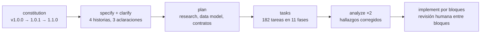

# Uso de IA

Cómo se usó la IA para construir este prototipo (constitución, principio IX): herramientas,
flujo, prompts clave, qué se revisó y corrigió a mano, e impacto. El detalle de cada
corrección está en [ia-log.md](ia-log.md).

## Herramientas

| Herramienta                        | Versión / modelo                                                                                                             | Para qué                                                                                    |
| ---------------------------------- | ---------------------------------------------------------------------------------------------------------------------------- | ------------------------------------------------------------------------------------------- |
| Claude Code (extensión de VS Code) | 2.1.327; modelo **Claude Opus 5.5** (`claude-opus-5-5`) en los bloques 3 a 5; familia Claude Opus en las sesiones anteriores | Especificación, plan, tareas, implementación, pruebas, revisión, mediciones y documentación |
| GitHub Spec Kit                    | 1.4.3.dev0 (skills `speckit-*` en `.claude/skills/`)                                                                         | Flujo guiado: constitución → spec → clarify → plan → tasks → analyze → implement            |
| Claude in Chrome                   | extensión de Chrome conectada a Claude Code                                                                                  | Validación manual del quickstart en el navegador (dos pestañas, pago, tablero, admin)       |
| Skill `angular-developer`          | incluida en Claude Code                                                                                                      | Convenciones de Angular 22: zoneless, signals, pruebas con Vitest                           |
| Playwright                         | 1.65.1 (con el Chrome instalado)                                                                                             | Prueba automatizada de dos pestañas (T179)                                                  |

## Flujo con Spec Kit

1. **`/speckit.constitution`**: 10 principios no negociables. La v1.1.0 integró los criterios
   de evaluación: SOLID verificable letra por letra, DRY, cobertura ≥ 80 % y el principio X de
   seguridad.
2. **`/speckit.specify` + `/speckit.clarify`**: 4 historias y 3 aclaraciones (reloj compartido
   por cliente y vuelo, clave de admin, consulta con código y correo). Los requisitos de
   experiencia de usuario (RUX-001 a RUX-036) se agregaron a mano.
3. **`/speckit.plan`**, con el contexto técnico de [prompts/plan.md](prompts/plan.md).
4. **`/speckit.tasks`** y **dos pasadas de `/speckit.analyze`**: se corrigieron todos los
   hallazgos críticos y altos antes de implementar.
5. **`/speckit.implement` por bloques**: 1 (fases 1–3), 2 (3b–4), 3 (5–6), 4 (7–8) y 5 (9–10),
   con revisión humana entre bloques. Los bloques 1 y 2 tienen su commit; los bloques 3 a 5 se
   implementaron seguidos y esperan revisión antes de su commit.

## Prompts clave

Se guardan completos en [prompts/](prompts/):

| Prompt                                                             | Qué fijó                                                                                                                                                                                                                                                                                   | Efecto en el código                                                                                                                                                        |
| ------------------------------------------------------------------ | ------------------------------------------------------------------------------------------------------------------------------------------------------------------------------------------------------------------------------------------------------------------------------------------ | -------------------------------------------------------------------------------------------------------------------------------------------------------------------------- |
| [prompts/plan.md](prompts/plan.md)                                 | Stack y decisiones técnicas: monorepo pnpm, módulos hexagonales, bloqueo con un único `UPDATE` condicional, advisory lock para el límite de 4, reloj compartido, idempotencia, eventos con `seq` tras el commit, rooms de Socket.io, mapa con CSS Grid accesible, pruebas e2e obligatorias | `HoldSeatUseCase`, `PrismaSeatHoldsAdapter`, `FlightRoomSync`, `seat-map.component`, `hold-concurrency.e2e-spec.ts`                                                        |
| [prompts/criterios-evaluacion.md](prompts/criterios-evaluacion.md) | Enmienda MINOR 1.1.0 (SOLID por letra, DRY, cobertura del 80 %, seguridad) y ajustes a spec, plan, research, contratos y tareas                                                                                                                                                            | Fase 3b: ESLint de complejidad, `test:cov`, helmet, throttler, `AdminKeyGuard`, marca de tarjeta; tablas "SOLID y DRY" y "Seguridad" de [architecture.md](architecture.md) |
| Instrucción del bloque 5                                           | "Pruebas primero en la fase 9"; README con los resultados reales de concurrencia, cobertura y tiempos; puertas de calidad y validación completa del quickstart                                                                                                                             | Pruebas T157–T160 escritas y en rojo antes del código; script de mediciones; validación desde cero con `docker compose` y en Chrome                                        |

Tres patrones de prompt que funcionaron:

- **Decisiones cerradas en el prompt**: el plan decía _cómo_ hacer la atomicidad (un `UPDATE`
  condicional; "nunca SELECT y luego UPDATE"), no solo _qué_. La IA no tuvo que adivinar el
  diseño crítico.
- **Criterios verificables**: "100 solicitudes → exactamente 1 éxito y 99 conflictos",
  `complexity` ≤ 10, cobertura ≥ 80 %. Cada criterio se volvió una prueba o una regla de ESLint.
- **Bloques con entrega y revisión**: cada bloque termina en verde (typecheck, lint, pruebas)
  y el siguiente empieza revisando ese estado: así se detectó C1.

## Qué se revisó y corrigió a mano

Resumen de [ia-log.md](ia-log.md):

- **Diseño**: carrera entre cancelar y bloquear (D1); barrido de 5 s → 2 s (D2); hallazgos de
  analyze sobre dependencias entre módulos, códigos HTTP y pool (D3); límite evadible rotando
  `X-Client-Id` (D4).
- **Versiones reales del ecosistema**: Prisma 7, TypeScript 6 y Nest 11 obligaron a ajustar el
  plan (B1).
- **Bugs que solo vieron las e2e**: fábrica de Nest con dependencias `null` (B2), y el gateway
  que no difundía ningún evento por un `@OnEvent` con arreglo (C2). Este último pasaba todas
  las pruebas unitarias.
- **Calidad del frontend**: formulario de pago que perdía lo escrito (C6); revisión de
  `innerHTML` que no cubría las plantillas en línea (C9); contrastes anotados sin medir (C10);
  formato del porcentaje (C11).
- **Pruebas de la propia IA**: expectativas mal calculadas (C13) y una medición engañosa de
  0 ms (C4).
- **Cierre de pendientes**: filtro `?flightId` que el contrato prometía (C15), la rama defensiva
  que dejaba `admin/application` al 75 % (C16) y el aviso de rutas de nestjs-pino (C17).
- **Proceso**: se detectó que se pedía el bloque 5 sin los bloques 3–4 hechos (C1). La IA paró
  y preguntó antes de editar.

## Impacto

| Aspecto           | Resultado                                                                                                        |
| ----------------- | ---------------------------------------------------------------------------------------------------------------- |
| Alcance entregado | 6 pantallas, 4 historias, 182 de 182 tareas, incluida la opcional T179                                           |
| Pruebas           | 356 automatizadas; las 5 críticas del principio V, contra PostgreSQL real                                        |
| Cobertura         | backend dominio y aplicación 99,8 % de líneas y 96,5 % de ramas; shared 100 % y 95,2 %                           |
| Integridad        | 100 bloqueos simultáneos → 1 × 201 y 99 × 409, en 5 de 5 ejecuciones                                             |
| Tiempo real       | propagación p95 de 13,9 ms entre clientes y 18–51 ms entre pestañas de Chrome; vencimiento notificado en ≤ 2,0 s |

### Tiempo ahorrado (estimación)

Línea de tiempo real, según los commits: el primer documento se hizo el 18-nov a las 17:49 y el
cierre el 19-nov a las 09:48. Son unas 17 h de reloj, con una pausa nocturna en medio. La
estimación sin IA es del autor: supone a una persona senior que ya conoce el stack y escribe a
mano la especificación, el código, las pruebas y la documentación con el mismo alcance.

| Área                                                          |       Sin IA (estimado) | Con IA                           | Dónde aportó más                                                                                |
| ------------------------------------------------------------- | ----------------------: | -------------------------------- | ----------------------------------------------------------------------------------------------- |
| Especificación, plan, research, contratos y tareas (Spec Kit) |                  8–12 h | ~1,5 h                           | Redacción y consistencia entre documentos; `/speckit-analyze` encontró inconsistencias (D3, D4) |
| Backend: dominio, casos de uso, adaptadores y seguridad       |                 16–24 h | ~3 h                             | Adaptadores Prisma con SQL atómico, dobles en memoria y pruebas de contrato                     |
| Frontend: 6 pantallas, stores y accesibilidad                 |                 16–24 h | ~3 h                             | Mapa accesible, sincronización por `seq` y formularios con los esquemas compartidos             |
| Pruebas e2e, mediciones y validación                          |                  8–12 h | ~2 h                             | Concurrencia, expiración, gateway, Playwright y script de tiempos                               |
| Documentación de entrega                                      |                   4–6 h | ~1 h                             | README, arquitectura y registro de IA con datos medidos                                         |
| **Total**                                                     | **52–78 h (7–10 días)** | **~10–11 h de trabajo efectivo** | **5 a 7 veces menos tiempo**                                                                    |

El tiempo "con IA" incluye la revisión humana entre bloques, pero no el tiempo de reflexión
sobre las decisiones de la constitución y del plan.

- **Dónde aceleró más**: código repetitivo pero exigente (adaptadores Prisma, dobles en memoria,
  pruebas de contrato, componentes accesibles, documentación con datos reales) y la
  trazabilidad spec → tarea → archivo.
- **Dónde hizo falta criterio humano**: el orden de entrega (C1), aceptar o rechazar
  desviaciones (presupuesto del bundle, instalar Playwright usando el Chrome local) y validar que lo medido tiene sentido
  (C4, C14).
- **Riesgo principal observado**: código que compila y pasa pruebas unitarias pero no funciona
  integrado (C2). Las e2e contra infraestructura real y la validación en el navegador fueron la
  defensa.
