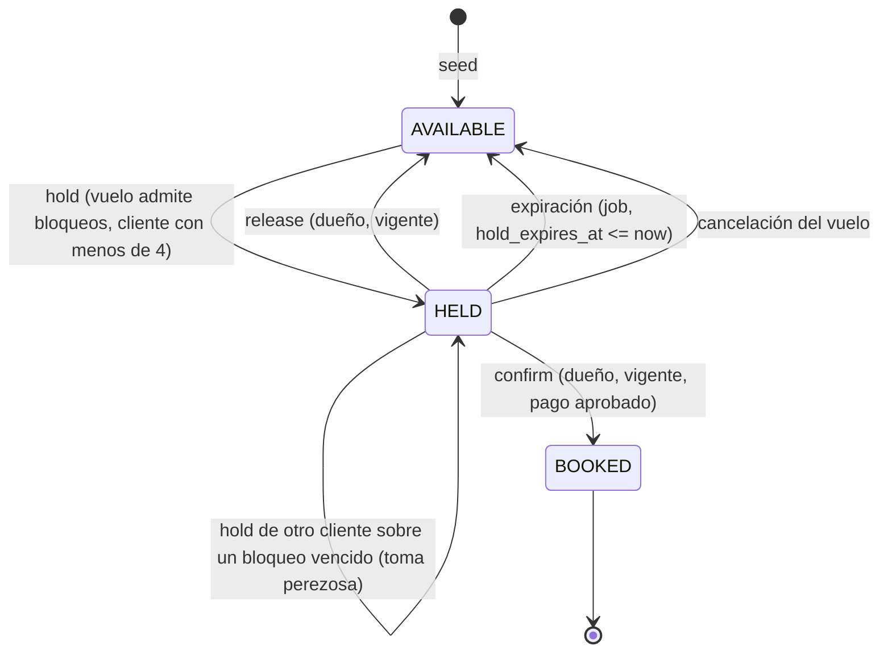

# Modelo de datos (Fase 1): Reservas de vuelos en tiempo real

**Fecha**: 2026-11-18 | **Plan**: [plan.md](./plan.md) | **Decisiones**: [research.md](./research.md)

Los nombres de tablas y columnas están en `snake_case` (PostgreSQL); los DTOs de
`@kata/shared` usan `camelCase`. Todas las fechas se guardan en UTC (`timestamptz`) y se
muestran en `America/Bogota`. Los importes son pesos colombianos enteros (sin decimales).

## Enums (`@kata/shared`)

| Enum | Valores | Equivalente en la spec |
|------|---------|------------------------|
| `SeatStatus` | `AVAILABLE`, `HELD`, `BOOKED` | DISPONIBLE, BLOQUEADO, RESERVADO |
| `FlightStatus` | `SCHEDULED`, `DELAYED`, `CANCELLED`, `SOLD_OUT` | PROGRAMADO, RETRASADO, CANCELADO, AGOTADO |
| `SeatType` | `WINDOW`, `MIDDLE`, `AISLE` | ventana (A, F), medio (B, E), pasillo (C, D) |
| `ReleaseReason` | `MANUAL`, `EXPIRED`, `FLIGHT_CANCELLED` | motivo de una liberación |
| `FlightEventType` | `SEAT_HELD`, `SEAT_RELEASED`, `SEAT_BOOKED`, `FLIGHT_UPDATED` | tipo de entrada del registro de actividad |

## Entidades y tablas

### `airports`

| Columna | Tipo | Reglas |
|---------|------|--------|
| `code` | `char(3)` PK | Uno de BOG, MDE, CLO, CTG, BAQ |
| `city` | `text` | No vacío |

### `flights`

| Columna | Tipo | Reglas |
|---------|------|--------|
| `id` | `uuid` PK | UUID v5 determinista en el seed |
| `flight_number` | `text` | Ej. `KT1234`; `UNIQUE(flight_number, scheduled_departure_at)` |
| `origin` | `char(3)` FK → `airports` | `origin <> destination` (CHECK) |
| `destination` | `char(3)` FK → `airports` | |
| `scheduled_departure_at` | `timestamptz` | Salida original; no cambia |
| `departure_at` | `timestamptz` | Salida vigente; ≥ `scheduled_departure_at` (CHECK) |
| `arrival_at` | `timestamptz` | `arrival_at > departure_at` (CHECK) |
| `fare` | `integer` | > 0; tarifa única por asiento en COP |
| `status` | `FlightStatus` | Ver transiciones del vuelo |
| `capacity` | `smallint` | 180 |
| `seq` | `bigint` | Default 0; secuencia de eventos del vuelo, solo aumenta |
| `created_at` / `updated_at` | `timestamptz` | |

Índices: `(origin, destination, departure_at)` para la búsqueda.

Campos derivados en `FlightDto`: `durationMinutes` (`arrival_at - departure_at`), `delayed`
(`departure_at > scheduled_departure_at`) y `availableSeats` (con verificación perezosa).

### `seats`

| Columna | Tipo | Reglas |
|---------|------|--------|
| `id` | `uuid` PK | Identificador interno |
| `flight_id` | `uuid` FK → `flights` | |
| `row` | `smallint` | 1–30 (CHECK) |
| `letter` | `char(1)` | A–F (CHECK) |
| `status` | `SeatStatus` | Default `AVAILABLE` |
| `held_by` | `uuid` null | `clientId` dueño del bloqueo; nunca se expone |
| `hold_expires_at` | `timestamptz` null | |
| `version` | `integer` | Default 0; +1 en cada transición |

Restricciones:

- `UNIQUE(flight_id, row, letter)`.
- CHECK de coherencia: `(status = 'HELD') = (held_by IS NOT NULL AND hold_expires_at IS NOT
  NULL)`.

Índices: `(flight_id, status)` para estadísticas; `(flight_id, held_by) WHERE status = 'HELD'`
para el límite y el reloj compartido; `(hold_expires_at) WHERE status = 'HELD'` para el job de
expiración.

En la API, `seatId` es el **código del asiento** (`12C` = fila + letra), único dentro del
vuelo. El tipo se deriva de la letra (A, F ventana; B, E medio; C, D pasillo) y el precio es la
tarifa del vuelo.

### `bookings`

| Columna | Tipo | Reglas |
|---------|------|--------|
| `id` | `uuid` PK | |
| `code` | `char(6)` UNIQUE | `^[A-Z0-9]{6}$` |
| `flight_id` | `uuid` FK → `flights` | |
| `client_id` | `uuid` | Cliente que compró |
| `buyer_name` | `text` | 2–100 caracteres |
| `buyer_email` | `text` | Correo válido; se guarda en minúsculas |
| `total` | `integer` | `fare × número de asientos` |
| `card_last4` | `char(4)` | Únicos dígitos de la tarjeta que se guardan |
| `created_at` | `timestamptz` | Fecha de confirmación |

Índice: `(code, buyer_email)` para la consulta del boleto.

### `booking_seats`

| Columna | Tipo | Reglas |
|---------|------|--------|
| `booking_id` | `uuid` FK → `bookings` | |
| `seat_id` | `uuid` FK → `seats` **UNIQUE** | Última defensa contra la doble reserva |
| `passenger_name` | `text` | 2–100 caracteres |

PK: `(booking_id, seat_id)`.

### `idempotency_keys`

| Columna | Tipo | Reglas |
|---------|------|--------|
| `client_id` | `uuid` | |
| `key` | `uuid` | Valor del header `Idempotency-Key` |
| `request_hash` | `char(64)` | SHA-256 del cuerpo normalizado |
| `booking_id` | `uuid` FK → `bookings` | |
| `created_at` | `timestamptz` | |

PK: `(client_id, key)`. Solo existen filas de confirmaciones exitosas (ver research §10).

### `flight_events`

| Columna | Tipo | Reglas |
|---------|------|--------|
| `flight_id` | `uuid` FK → `flights` | |
| `seq` | `bigint` | Igual a `flights.seq` tras el evento |
| `type` | `FlightEventType` | |
| `seat_code` | `char(3)` null | Ej. `12C`; nulo en `FLIGHT_UPDATED` |
| `payload` | `jsonb` | Payload completo del evento publicado (sin `clientId`) |
| `occurred_at` | `timestamptz` | Hora del reloj inyectado |

PK: `(flight_id, seq)`. Alimenta el registro de actividad del tablero (últimos 50).

### Identidad del cliente (sin tabla)

- `clientId`: UUID v4 generado por el navegador, enviado en `X-Client-Id`.
- `holderTag`: primeros 16 caracteres hexadecimales de SHA-256(`clientId`); es lo único que se
  difunde sobre el dueño de un bloqueo.

## Máquina de estados del asiento

| # | Transición | Disparador | Condición atómica (`UPDATE ... WHERE`) | Respuesta si no cumple | Evento |
|---|------------|------------|----------------------------------------|------------------------|--------|
| T1 | AVAILABLE → HELD | `POST .../hold` | `status = 'AVAILABLE' OR (status = 'HELD' AND hold_expires_at < :now)`; vuelo bloqueado previamente con `status IN (SCHEDULED, DELAYED) AND departure_at > :now`; cliente con menos de 4 bloqueos vigentes | 409 `SEAT_UNAVAILABLE`, 409 `FLIGHT_NOT_BOOKABLE`, 422 `HOLD_LIMIT_REACHED` | `seat:held` |
| T2 | HELD (vencido) → HELD | `POST .../hold` de otro cliente | Igual que T1 (rama `hold_expires_at < :now`) | Igual que T1 | `seat:held` (con el nuevo `holderTag`) |
| T3 | HELD → AVAILABLE | `DELETE .../hold` | `status = 'HELD' AND held_by = :client AND hold_expires_at > :now` | 409 `SEAT_NOT_HELD` | `seat:released` (`MANUAL`) |
| T4 | HELD → AVAILABLE | Job de expiración | `status = 'HELD' AND hold_expires_at <= :now` | — | `seat:released` (`EXPIRED`) |
| T5 | HELD → AVAILABLE | Cancelación del vuelo | `flight_id = :f AND status = 'HELD'` | — | `seat:released` (`FLIGHT_CANCELLED`) |
| T6 | HELD → BOOKED | `POST /bookings` | `status = 'HELD' AND held_by = :client AND hold_expires_at > :now AND code IN (:asientos)`; conteo = asientos solicitados = bloqueos vigentes del cliente | 410 `HOLD_EXPIRED`, 422 `PASSENGERS_MISMATCH`, 409 `FLIGHT_NOT_BOOKABLE`, 402 `PAYMENT_DECLINED` (rollback) | `seat:booked` |

Al pasar a `AVAILABLE` se ponen a `NULL` `held_by` y `hold_expires_at`. Toda transición
incrementa `version`. `BOOKED` es terminal.

**Vencimiento compartido (T1)**: si el cliente ya tiene bloqueos vigentes en el vuelo, el
asiento nuevo recibe su mismo `hold_expires_at`; si no, `:now + HOLD_TTL_SECONDS`. Se calcula
bajo `pg_advisory_xact_lock(clientId, flightId)` dentro de la transacción.

**Vista perezosa**: en snapshots, estadísticas y búsqueda, un asiento `HELD` con
`hold_expires_at <= :now` se presenta como `AVAILABLE`.

## Transiciones del vuelo

```mermaid
stateDiagram-v2
    [*] --> SCHEDULED: seed
    SCHEDULED --> DELAYED: admin retrasa
    DELAYED --> DELAYED: admin retrasa de nuevo
    SCHEDULED --> SOLD_OUT: se reserva el último asiento
    DELAYED --> SOLD_OUT: se reserva el último asiento
    SOLD_OUT --> SOLD_OUT: admin retrasa (cambia horas, conserva estado)
    SCHEDULED --> CANCELLED: admin cancela
    DELAYED --> CANCELLED: admin cancela
    SOLD_OUT --> CANCELLED: admin cancela
    CANCELLED --> [*]
```

| Regla | Respuesta si no cumple |
|-------|------------------------|
| Retrasar exige `newDepartureAt > departure_at`; `arrival_at` se desplaza lo mismo | 422 `INVALID_DELAY` |
| Un vuelo `CANCELLED` no admite cambios | 409 `FLIGHT_STATUS_CONFLICT` |
| Solo `SCHEDULED` o `DELAYED` con `departure_at > now` admiten bloqueos y confirmaciones | 409 `FLIGHT_NOT_BOOKABLE` |
| `SOLD_OUT` solo lo pone el sistema, nunca el administrador | 422 `VALIDATION_ERROR` |

## Invariantes

1. Un asiento tiene como máximo un dueño: `held_by` es una sola columna y `booking_seats.seat_id`
   es `UNIQUE`.
2. Un cliente tiene como máximo 4 bloqueos vigentes por vuelo, y todos comparten el mismo
   `hold_expires_at`.
3. `available + held + booked = capacity` en cualquier estadística (con vista perezosa).
4. `flights.seq` aumenta en 1 por evento y su orden coincide con el orden de commit (lock de la
   fila del vuelo; orden de locks vuelo → advisory → asientos).
5. Un vuelo `SOLD_OUT` tiene todos sus asientos `BOOKED`.
6. Un vuelo `CANCELLED` no tiene asientos `HELD`.

## Validaciones de entrada (esquemas zod en `@kata/shared`)

| Esquema | Reglas |
|---------|--------|
| `SearchFlightsQuery` | `origin`, `destination` ∈ aeropuertos; `origin ≠ destination`; `date` `YYYY-MM-DD` ≥ hoy en Bogotá |
| `CreateBookingRequest` | `flightId` uuid; `buyer.name` 2–100; `buyer.email` correo; `passengers` 1–4 elementos `{ seatId: ^([1-9]|[12][0-9]|30)[A-F]$, name 2–100 }` sin asientos repetidos; `card.number` 16 dígitos; `card.expiry` `MM/YY` futuro; `card.cvv` 3 dígitos |
| `BookingLookupRequest` | `code` `^[A-Z0-9]{6}$` (se normaliza a mayúsculas); `email` correo (se normaliza a minúsculas) |
| `UpdateFlightStatusRequest` | `{ status: 'DELAYED', newDepartureAt: ISO 8601 }` o `{ status: 'CANCELLED' }` |
| Headers | `X-Client-Id` uuid; `Idempotency-Key` uuid; `X-Admin-Key` texto no vacío |

**Tarjeta ficticia de rechazo**: `4000 0000 0000 0002`. Cualquier otra tarjeta con formato válido
se aprueba. Nunca se guarda ni se registra en logs el número completo ni el CVV.
